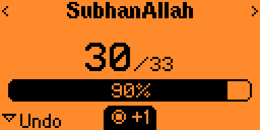
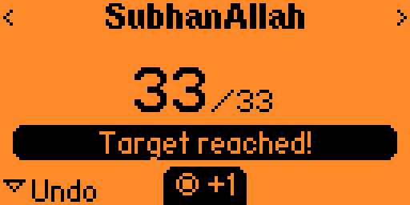
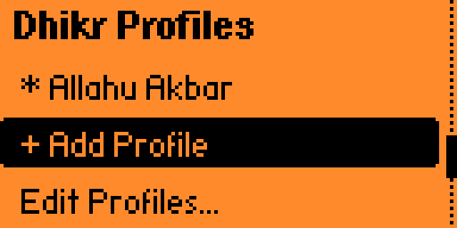
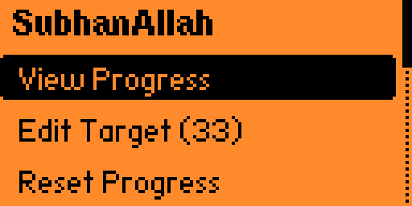
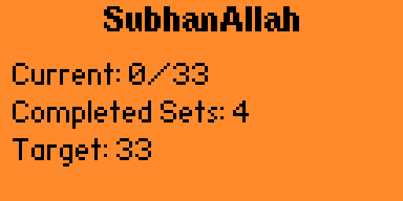
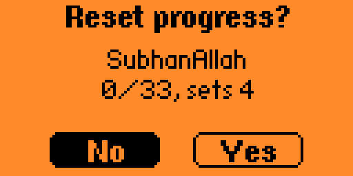
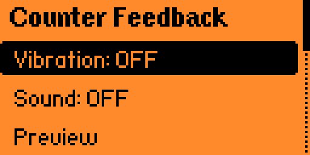
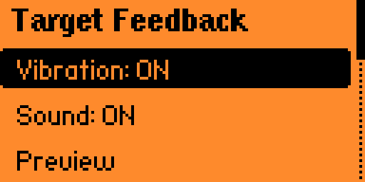

# Flipper Dhikr

A digital **tasbih counter** for the [Flipper Zero](https://flipperzero.one/), written in C
as a native `.fap` application.

Count with the OK button: when the target (33, 99 or any value from 1 to 9999) is reached,
the app shows **"Target reached!"**, gives a distinct vibration/sound signal, records one
completed set and starts again at 0. Mistakes can be undone. Built-in profiles and up to 13 custom
ones keep independent counts, and everything is stored on the SD card.

> **Status: v1.0.3 – not yet fully validated on hardware.**
> v1.0.3 brings a shorter main menu, a details menu per profile (View Progress, Edit Target,
> Reset Progress, …), a simpler counter screen and a new app icon. All 74 host unit tests pass
> and both builds (Momentum mntm-012, official 1.5.1) complete without warnings. The
> screenshots below were taken with qFlipper on a real Flipper Zero, but the v1.0.3 hardware
> checklist has not been completed yet.
>
> The latest published and hardware-validated release is **v1.0.2** (Momentum, 9/9 prioritised
> tests passed).

## Screenshots

| | |
|---|---|
|  |  |
| Counter | Target reached, automatic restart |
|  |  |
| Dhikr Profiles (`*` = active) | Profile details |
|  |  |
| View Progress with completed sets | Reset Progress confirmation (No pre-selected) |
|  |  |
| Counter Feedback | Target Feedback |

Unmodified qFlipper captures; more in [screenshots/](screenshots/README.md).

---

## Features

|                           |                                                                                                                                                                                                                                                                                |
| ------------------------- | ------------------------------------------------------------------------------------------------------------------------------------------------------------------------------------------------------------------------------------------------------------------------------ |
| **Tasbih counter**        | Large count display, target, progress bar with percentage. OK adds exactly one.                                                                                                                                                                                                |
| **Sets (auto restart)**   | A set is one complete pass up to the target. The count that reaches the target completes the set: "Target reached!" shows for about 1 s, the completion signal plays once, one set is recorded and the count restarts at 0. Completed sets are shown in **View Progress**.     |
| **Undo**                  | Hold **Down** to take back the last count (never below 0). Directly after a completed set, undo restores that set.                                                                                                                                                             |
| **Targets**               | 33, 99 or a custom value 1–9999 per profile, set under **Dhikr Profiles → hold OK → Edit Target**. Changing the target never clears the count or the completed sets.                                                                                                           |
| **Profiles**              | SubhanAllah, Alhamdulillah, Allahu Akbar (built-in, cannot be renamed or deleted), Custom Dhikr, plus your own profiles. Add, rename and delete custom profiles (max. 16 profiles in total). Each profile has a details menu.                                                  |
| **View Progress**         | Per profile, read-only: current count, target and completed sets. Works for any profile, not only the active one.                                                                                                                                                              |
| **Safe reset / delete**   | **Reset Progress** per profile (count and sets to 0) and **Delete Profile**, each with a dialog that names the profile and has **No** pre-selected. Back cancels.                                                                                                              |
| **Feedback**              | Four independent switches: **Counter** vibration/sound (short tick per count) and **Target** vibration/sound (distinct pattern plus a green LED when a set is complete). Default: quiet counting, vibration + sound at the target. Respects the system settings (see below). |
| **Persistence**           | Versioned, CRC-protected settings file with crash-safe writes. v1.0 / v1.0.1 data is migrated automatically; v1.0.2 data is used as-is.                                                                                                                                       |
| **App icon**              | 10×10 crescent with a five-pointed star, shown in **Apps → Tools**.                                                                                                                                                                                                            |

The default profiles are plain, configurable counters. The app makes no claim about how often
any dhikr should be recited.

## Controls

**Main menu**

```
Flipper Dhikr
  Start Counting
  Dhikr Profiles        <- select a profile; hold OK for its details
  Feedback Settings
  About
```

Back on the main menu exits the app. Targets and resets are managed per profile in its
details menu, so it is always clear which profile they change.

**Counter screen**

| Button           | Action                                              |
| ---------------- | --------------------------------------------------- |
| OK (short press) | Count +1                                            |
| Down (hold)      | Undo the last count (once per hold, no auto-repeat) |
| Left / Right     | Previous / next profile (counts are kept)           |
| Back             | Back to the main menu (progress is saved)           |

Holding OK does **not** count. Up does nothing. The bottom row reminds you: `▼Undo`, `(+1)`
and `Muted` when stealth mode is silencing the feedback.

```
<      SubhanAllah      >
         29 /33
[########       87%      ]
▼Undo      (+1)
```

The screen shows the profile name, the count, the target and a progress bar with the
percentage. Completed sets are shown in **View Progress**, not on the counter screen.

**What you see at the target (example: target 33):** `32/33` → OK → **`33/33 Target
reached!`** (about 1 s, signal plays once) → `0/33`. One completed set is recorded. A press
during the message already counts as 1 of the next set, so no count is lost.

Sets are counted per profile. They are a simple tally of completed passes: they are not
converted into a total number of repetitions, so changing the target later does not change
them.

**Undo directly after a completed set:** `0/33` → hold Down → `32/33`, "Set undone", and
the recorded set is removed again. After any further count, undo works normally on the
current count. When the count is 0 and no set can be restored, the app shows "Nothing to
undo" and the count stays at 0.

**Dhikr Profiles**

```
Dhikr Profiles
* SubhanAllah          <- "*" = active profile
  Alhamdulillah
  Allahu Akbar
  Custom Dhikr
  Istighfar
  + Add Profile
  Edit Profiles...
```

| Button               | Action                                                         |
| -------------------- | -------------------------------------------------------------- |
| OK on a profile      | Make it active. The list stays open and the `*` moves at once. |
| Hold OK on a profile | Details of **that** profile (it does not become active)        |
| `+ Add Profile`      | Enter a name, then a target. The new profile becomes active.   |
| `Edit Profiles...`   | Pick a profile, then the same details (no need to hold OK)     |
| Back                 | Main menu                                                      |

The highlighted profile and the active profile are different things: the `*` shows which
profile the counter uses; holding OK opens the details of the highlighted one.

**Profile details** (header = profile name):

```
SubhanAllah               Istighfar
  View Progress             View Progress
  Edit Target (33)          Edit Target (100)
  Reset Progress            Rename Profile
                            Reset Progress
                            Delete Profile
```

| Entry            | What it does                                                                                     |
| ---------------- | ------------------------------------------------------------------------------------------------ |
| `View Progress`  | Read-only page: `Current: 15/100`, `Completed Sets: 4`, `Target: 100`. Back returns.             |
| `Edit Target`    | 33 times / 99 times / Custom value... Saved at once, back to the details (shows the new value).  |
| `Rename Profile` | Custom profiles only.                                                                            |
| `Reset Progress` | `Reset progress?` dialog with the profile name, count and sets; **No** pre-selected.             |
| `Delete Profile` | Custom profiles only, with a confirmation.                                                       |

**Reset Progress** sets the count **and** the completed sets of that one profile to 0. Its
target, name, all other profiles and the active profile stay unchanged. Yes saves at once and
returns to the details of the same profile; No or Back cancel. A reset cannot be undone with
hold Down.

None of these entries changes which profile is active.

Names: 1–16 printable characters. Names must be unique (ignoring upper/lower case) and must
not be empty. The Flipper keyboard only offers ASCII characters.

**Menus**: Up/Down to move, OK to select, Back to go up one level. Back on the main menu exits.

## Vibration and sound: system settings

Flipper Dhikr never overrides global settings. If you feel or hear nothing:

| Setting (on the Flipper)                    | Effect                                                                                                                              |
| ------------------------------------------- | ----------------------------------------------------------------------------------------------------------------------------------- |
| **Stealth mode** (Momentum: lock menu)      | Mutes all vibration and sound. The app shows **"Muted"** on the counter screen and `Stealth: ON (muted)` in Feedback Settings.      |
| **Settings → Notifications → Vibro** = Off  | No vibration (the app cannot read this setting)                                                                                     |
| **Settings → Notifications → Volume** = 0 % | No sound (the app cannot read this setting)                                                                                         |
| App: all four feedback switches OFF         | No vibration, no sound, no LED                                                                                                      |

## Feedback Settings

```
Feedback Settings          Counter Feedback        Target Feedback
  Counter Feedback  >        Vibration: OFF          Vibration: ON
  Target Feedback  >         Sound: OFF              Sound: ON
  Stealth: Off               Preview                 Preview
  Help
```

- **OK** on `Vibration` / `Sound` switches it ON ↔ OFF. The label changes at once.
- **Preview** plays this event's pattern with the current switches; if both are OFF,
  nothing plays.
- **Back** goes up one level. Changes are saved when you leave the page.
- `Stealth: ON (muted)` shows that stealth mode is silencing everything; OK on it or on
  `Help` opens the help page.

The four switches are independent. Examples:

| Counter vib. | Counter sound | Target vib. | Target sound | Result                                                                                                                             |
| ------------ | ------------- | ----------- | ------------ | ---------------------------------------------------------------------------------------------------------------------------------- |
| OFF          | OFF           | ON          | ON           | Silent counting, vibration + melody at 33/33 (**default for new installs**)                                                        |
| ON           | OFF           | OFF         | ON           | Tick vibration on each count, melody only at the target                                                                            |
| ON           | ON            | OFF         | OFF          | Feedback on every count, nothing extra at the target (the target press stays silent; the "Target reached!" message is still shown)  |
| OFF          | OFF           | OFF         | OFF          | No vibration or sound at all                                                                                                       |

A completed target plays **only** the target pattern, never the counter tick in addition.

**Updating from v1.0 / v1.0.1:** your previous setting is converted so nothing changes for
you: Off → all OFF, Vibration → both vibration switches ON, Sound → both sound switches ON,
Both → all ON.

## Requirements

- Flipper Zero with an SD card
- Firmware: **Momentum** `mntm-012` (or newer with API 87.x), or official `1.5.x` (API 88)
  with the matching build
- To build: macOS or Linux with Python 3.8+ and
  [uFBT](https://github.com/flipperdevices/flipperzero-ufbt)

A `.fap` only runs on firmware whose API major version matches the SDK it was built with.

## Build (macOS)

```bash
python3 -m venv .venv
.venv/bin/pip install --upgrade ufbt

scripts/build.sh            # Momentum + official (SDKs go to .ufbt-momentum/, .ufbt-official/)
scripts/build.sh momentum   # only one
```

Output (one folder per app version, older builds are kept):

```
dist/v1.0.3/momentum-mntm-012/flipper_dhikr.fap   (+ BUILD_INFO.txt)
dist/v1.0.3/official-1.5.1/flipper_dhikr.fap
```

### Tests

```bash
make -C tests     # 74 host unit tests, AddressSanitizer + UBSan
```

## Install on the Flipper Zero

Prebuilt `.fap` files for published versions are attached to the
[GitHub releases](https://github.com/NirochiCode/flipper-dhikr/releases) (one per firmware).
Until v1.0.3 is released, build it yourself as shown above. A submission to the official
Flipper Apps Catalog is being prepared.

Choose **one** of these options:

1. **qFlipper**: copy `dist/v1.0.3/momentum-mntm-012/flipper_dhikr.fap` to
   `SD Card/apps/Tools/`, replacing the old file.
2. **SD card reader**: copy the file to `apps/Tools/` on the card.
3. **uFBT over USB** (close qFlipper first):
   `UFBT_HOME=$PWD/.ufbt-momentum .venv/bin/ufbt launch`

Then open it under **Apps → Tools → Flipper Dhikr**. Existing v1.0 / v1.0.1 data is migrated
automatically on first start; v1.0.2 data is used as-is (same format). None of these methods change the firmware.

## Data storage

`SD:/apps_data/flipper_dhikr/settings.txt` is a small text file with a format version and a
CRC-32 checksum.

| When                                                | What happens                                                                                                                      |
| --------------------------------------------------- | --------------------------------------------------------------------------------------------------------------------------------- |
| Completed set, undo                                 | Saved immediately (at most every 3 s; otherwise via autosave)                                                                     |
| Profile selected / added / renamed / deleted        | Saved immediately                                                                                                                 |
| Reset Progress (confirmed)                          | Saved immediately                                                                                                                 |
| Target changed (Edit Target)                        | Saved immediately                                                                                                                 |
| Leaving the counter, main menu, exit                | Saved if anything changed                                                                                                         |
| While counting                                      | Autosave at most every 15 s after the first unsaved change                                                                        |
| First start after an update                         | Older formats are migrated to format v3; the original is kept as `settings.v1.bak` (from v1.0) or `settings.v2.bak` (from v1.0.1) |
| Damaged file / file from a newer version            | Renamed to `settings.bak`, defaults loaded, notice shown                                                                          |
| SD card not readable                                | Defaults loaded, saving disabled for the session, notice shown                                                                    |

> **Power loss:** counts from the last ~15 s may be lost. The previous saved state stays
> intact, because writes go to a temporary file first and are then renamed.

## Development status

| Area                                  | Status                                                                                |
| ------------------------------------- | ------------------------------------------------------------------------------------- |
| v1.0 features                         | ✅ tested on hardware (Momentum) by the user                                          |
| v1.0.1 features                       | ✅ the 9 prioritised hardware tests passed (Momentum)                                 |
| v1.0.2 independent feedback           | ✅ 9/9 prioritised hardware tests passed (Momentum); extended checklist still open    |
| v1.0.3 menu, profile details, reset   | ⏳ hardware checklist open (see docs/HARDWARE_TESTS.md); screens captured on a device |
| v1.0.3 app icon                       | ✅ 10×10, 1-bit, pixel-checked (`scripts/generate_icon.py --check`); ⏳ device check |
| Build, Momentum `mntm-012` (API 87.1) | ✅ no warnings, APPCHK passed                                                         |
| Build, official `1.5.1` (API 88.2)    | ✅ no warnings, APPCHK passed                                                         |
| Host unit tests                       | ✅ 74/74 (ASan + UBSan), including all 16 switch combinations                         |
| Static analysis                       | ✅ clang `--analyze` (logic) and GCC `-fanalyzer` (all firmware sources): no findings |
| Screenshots                           | ✅ 17 qFlipper captures of v1.0.3 (`scripts/check_screenshots.py`: 512×256, 2 colours) |

## Known limitations

- While the target pattern plays (~0.6 s), further vibration/sound ticks are skipped. The counts
  themselves are always kept. With very small targets (e.g. 1) and fast pressing, not every
  completed set gets its own sound/vibration, but each one shows "Target reached!".
- System Vibro/Volume cannot be read via the public SDK, so only stealth mode is detected.
- Undo restores a completed set only directly after it, and only within the same app session.
- In the settings file and the source code, completed sets are still called `rounds`
  (unchanged format v3).
- Host tests cover the logic, menu contents and texts, not the screens themselves; screen
  layout and navigation are checked on the device (docs/HARDWARE_TESTS.md).
- Up to ~15 s of counts can be lost on power loss.
- English UI and ASCII names only.

## Roadmap

See [docs/ROADMAP.md](docs/ROADMAP.md).

## Project layout

```
application.fam      app manifest (appid flipper_dhikr)
src/, include/       C sources and headers (logic, storage, feedback, views, scenes)
assets/              10x10 app icon (crescent and star, see scripts/generate_icon.py)
screenshots/         unmodified qFlipper screenshots (catalog/ = Apps Catalog set)
tests/               host unit tests (make -C tests)
scripts/             build.sh (Momentum + official builds), icon and screenshot checks
docs/                ARCHITECTURE, ROADMAP, CHANGELOG, HARDWARE_TESTS, SCREENSHOT_CHECKLIST,
                     catalog-description.md, catalog-changelog.md (Apps Catalog texts)
```

## License

[MIT](LICENSE)
